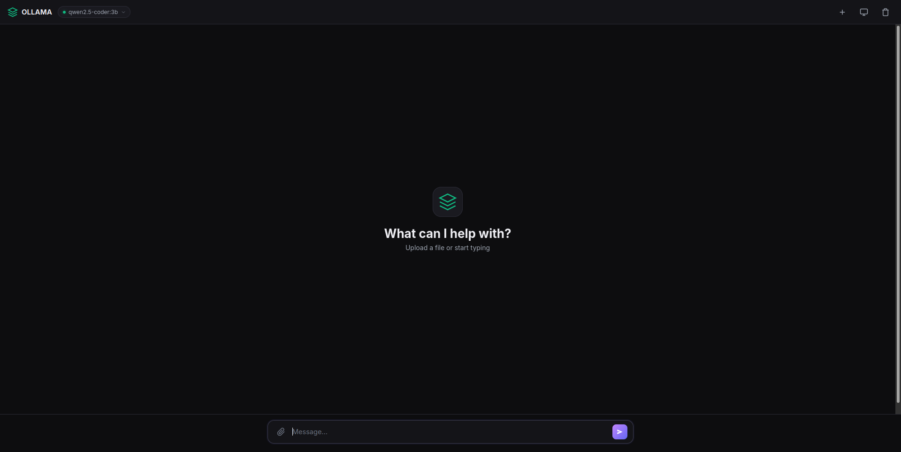
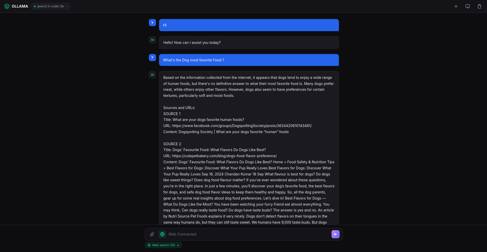

# OLLAMA WEB UI V2 + HULK

A locally hosted AI chat interface powered by **Ollama**, with streaming responses, file reading, Tavily web search, and Gmail tools.

> **Version note:** The uploaded project folder is named `OLLAMA-UI-V2`, while the application banner and existing project README identify the interface as **OLLAMA WEB UI V4 + HULK**. This README calls the uploaded project V2 to match its folder name.

---

## Screenshots

### Main Ollama chat interface



### Web search interface



---

## Features

### 1. Local AI chat

- Connects to your local Ollama server.
- Streams model responses into the browser.
- Lists locally installed Ollama models in the model selector.
- Lets you start a new chat, clear the current chat, and stop generation.
- Uses the Ollama chat API; prompts are processed by the model selected for the chat.

### 2. File upload and reading

- Upload supported text, source-code, configuration, and PDF files.
- PDF text is extracted with `PyPDF2`.
- The Flask upload endpoint accepts files up to **16 MB**.
- The extracted text sent back to the browser is limited to **12,000 characters**.

Supported examples include `.pdf`, `.txt`, `.md`, `.py`, `.js`, `.html`, `.css`, `.java`, `.c`, `.cpp`, `.json`, `.xml`, `.yaml`, `.yml`, `.toml`, `.sql`, `.sh`, and other common text/code formats. Binary files and unsupported formats are not intended for upload.

### 3. Tavily web search

- Uses the Tavily Search API instead of the older DuckDuckGo approach.
- Searches the web and passes up to four search results to the selected chat model as context.
- Displays search status while the response is being generated.
- The model is instructed to answer using the returned search information and include source URLs.

A Tavily API key is required for web search. Normal local chat does not require Tavily.

### 4. Gmail integration

Gmail access is optional and uses Google OAuth.

Available actions in Gmail mode:

1. **CONNECT GMAIL KEY** — authorizes the application with Google.
2. **MAIL READ** — reads between 1 and 5 recent emails.
3. **ANALYZE MAILS** — asks the local Ollama model to analyse each retrieved email.
4. **GENERATE DRAFT** — generates an email draft from a recipient and topic.
5. **SAVE DRAFT TO GMAIL** — saves the generated draft to Gmail Drafts.

The application uses Gmail read-only and compose scopes. The draft function creates a Gmail draft; it does **not** send the email.

### 5. Interface and keyboard shortcuts

- Dark glass-style interface with an animated background.
- Model selector and service status indicator.
- Gmail selection panel.
- File upload control.
- Keyboard shortcuts:
  - `ENTER` — send message
  - `SHIFT + ENTER` — add a new line
  - `CTRL + SHIFT + N` — new chat
  - `CTRL + L` — clear chat
  - `ESC` — stop generation

---

## V1 vs V2: what is different?

The V1 description supplied with this project already lists Tavily search, Gmail OAuth, mail reading, AI analysis, draft generation, and the glass-style interface. The uploaded V2 source code contains these same core features, so it would be inaccurate to claim that all of them are newly introduced in V2.

| Area | V1 description | Verified in uploaded V2 source |
|---|---|---|
| Ollama chat | Streaming chat | Flask `/api/chat` streams responses from Ollama |
| Model selection | Any Ollama model | `/api/models` retrieves installed models; the UI has a model selector |
| File upload | PDF, code, text | Upload endpoint supports PDF and many text/code formats; 16 MB upload limit and 12,000-character response limit |
| Web search | Tavily replaces DuckDuckGo | Tavily API search is integrated into the chat request flow; up to four results are used |
| Gmail connection | Google OAuth | Gmail OAuth connect endpoint is present |
| Read emails | Select 1–5 | Gmail read endpoint limits the count to 1–5 |
| Analyse emails | AI summary | Each retrieved email is analysed with the local Ollama client |
| Generate draft | Recipient + topic | Draft generation endpoint is present |
| Save draft | Save to Gmail; never auto-send | Gmail Drafts API is used; no send operation is present in the draft function |
| Interface | Glassmorphism and uppercase labels | Glass-style UI, Gmail panel, model selector, and uppercase interface labels are present |
| Keyboard shortcuts | Preserved | Shortcuts are shown in the UI and handled in the JavaScript |

### Important comparison limitation

Only the V1 feature description was supplied; the V1 source-code folder was not. Therefore, this table compares the V1 description with the actual V2 code. It cannot confirm every internal code change, bug fix, or performance difference between the two source-code versions.

---

## Requirements

- Linux (instructions below are for Fedora; other Linux distributions can use their equivalent package manager).
- Python 3.10 or newer recommended.
- Ollama installed and running.
- At least one Ollama model downloaded.
- Internet access for Tavily web search and Google OAuth.
- A Tavily API key for web search.
- Google OAuth Desktop credentials for Gmail features.

The model runs locally through Ollama. Tavily search and Google Gmail authorization require network access.

---

## 1. Install Ollama

On Fedora, install Ollama using its official Linux installer:

```bash
curl -fsSL https://ollama.com/install.sh | sh
```

Start the Ollama service:

```bash
sudo systemctl enable --now ollama
```

Check that Ollama is available:

```bash
ollama --version
ollama list
```

If your system does not use the Ollama system service, start the server manually in a separate terminal:

```bash
ollama serve
```

Keep the Ollama server running while using the web UI.

Official installation instructions: <https://ollama.com/download>

---

## 2. Download an Ollama model

The example configuration uses:

```text
qwen2.5:1.5b
```

Download it:

```bash
ollama pull qwen2.5:1.5b
```

Check that it is installed:

```bash
ollama list
```

You can test it in the terminal:

```bash
ollama run qwen2.5:1.5b
```

Type a message, then enter `/bye` to exit.

### Can V1 and V2 use the same Ollama model?

**Yes.** Both versions can use the same model installed in the same Ollama service. You do not need to download the model twice.

For this V2 project, set the model in the project's `.env` file:

```env
OLLAMA_URL=http://localhost:11434
OLLAMA_MODEL=qwen2.5:1.5b
```

If you prefer another installed model, replace `qwen2.5:1.5b` with its exact name from:

```bash
ollama list
```

For example, if you already have `qwen2.5-coder:3b` installed, you can set:

```env
OLLAMA_MODEL=qwen2.5-coder:3b
```

Then make sure that model is available:

```bash
ollama pull qwen2.5-coder:3b
```

**Model selection detail in this source:** normal browser chat sends the model selected in the UI to Ollama. Gmail analysis and draft generation use `OLLAMA_MODEL` from `.env` through `hulk/config.py`. To make Gmail use the same model as your normal chat, set `OLLAMA_MODEL` to that model's exact name. The Gmail endpoints currently receive a selected-model field, but the Gmail AI helper functions do not use that field.

---

## 3. Download or extract the project

Open a terminal in the directory where you want the project:

```bash
cd ~/Projects
```

Extract the ZIP if it is still in your Downloads folder:

```bash
unzip ~/Downloads/OLLAMA-UI-V2.zip
cd OLLAMA-UI-V2
```

If you cloned the GitHub repository instead, enter the repository folder:

```bash
cd ~/Projects/OLLAMA-UI
```

Use the actual folder name on your computer.

---

## 4. Install Python dependencies

On Fedora, install the Python and virtual-environment tools if needed:

```bash
sudo dnf5 install python3 python3-pip
```

Create and activate a virtual environment inside the project:

```bash
python3 -m venv .venv
source .venv/bin/activate
```

Upgrade pip and install the project requirements:

```bash
python -m pip install --upgrade pip
python -m pip install -r requirements.txt
```

The project requirements include Flask, Requests, PyPDF2, python-dotenv, and the Google API/OAuth libraries.

---

## 5. Configure environment variables

Create your local environment file:

```bash
cp .env.example .env
```

Open it:

```bash
nano .env
```

Use this structure and enter your own API key:

```env
OLLAMA_URL=http://localhost:11434
OLLAMA_MODEL=qwen2.5:1.5b

TAVILY_API_KEY=YOUR_TAVILY_API_KEY

GMAIL_CLIENT_FILE=credentials.json
GMAIL_TOKEN_FILE=token.json
GMAIL_MAX_READ=5
```

Save in Nano with `CTRL + O`, press `ENTER`, then exit with `CTRL + X`.

Get a Tavily API key from: <https://tavily.com/>

Do not commit `.env` to GitHub.

---

## 6. Configure Gmail (optional)

To use Gmail features:

1. Open Google Cloud Console: <https://console.cloud.google.com/>
2. Create or select a Google Cloud project.
3. Enable the **Gmail API**.
4. Configure the OAuth consent screen for your Google account.
5. Create an OAuth client ID with application type **Desktop app**.
6. Download the OAuth client JSON file.
7. Place it in the project root and name it:

```text
credentials.json
```

The project configuration expects `credentials.json` in the root folder by default.

Start the web UI, open Gmail mode, and choose **CONNECT GMAIL KEY**. Complete Google's browser authorization. The application will create `token.json` for the authorized session.

Keep both files private:

- `credentials.json`
- `token.json`

The project uses Gmail read-only and compose permissions. Review the Google consent screen before authorizing access.

---

## 7. Start the web UI

Make sure the virtual environment is active and Ollama is running.

From the project root:

```bash
source .venv/bin/activate
python app.py
```

Open this address in your browser:

<http://127.0.0.1:5000>

Stop the Flask application with `CTRL + C`.

### Optional: run the terminal HULK interface

The repository also contains a terminal interface in `hulk/cli.py`. To start it:

```bash
python -m hulk.cli
```

Use the web UI command above for the browser-based interface.

---

## Troubleshooting

### Ollama is not reachable

Check the service:

```bash
systemctl status ollama
```

Or start it manually:

```bash
ollama serve
```

Check the local API:

```bash
curl http://localhost:11434/api/tags
```

### Model is missing

```bash
ollama list
ollama pull qwen2.5:1.5b
```

Make sure `OLLAMA_MODEL` in `.env` matches the installed model name.

### Tavily search does not work

- Confirm `TAVILY_API_KEY` is set in `.env`.
- Check that the key is valid and has available usage.
- Restart `python app.py` after changing `.env`.

### Gmail connection fails

- Confirm `credentials.json` exists in the project root.
- Confirm the Gmail API is enabled in Google Cloud.
- Confirm the OAuth client is a Desktop app.
- Complete the Google authorization in the browser.
- If the token is invalid, remove the local `token.json` and connect again.

### Port 5000 is already in use

Find the process using the port:

```bash
sudo ss -ltnp | grep :5000
```

Stop the other application using that port, or change the Flask port in `app.py` and open the matching URL.

---

## Security

**Never upload or commit these files:**

```text
.env
credentials.json
token.json
.venv/
__pycache__/
```

The repository `.gitignore` excludes the main secret files, but always verify before pushing:

```bash
git status --short
git ls-files .env credentials.json token.json
```

The second command should print nothing.

If a secret has already been pushed to a public Git repository, deleting the file in a later commit is not enough. Revoke or rotate the exposed API key/OAuth credentials, then clean the Git history if necessary.

Do not include your `.git` directory, Python cache folders, virtual environment, or personal credentials in a ZIP shared publicly.

---

## Project structure

```text
OLLAMA-UI-V2/
├── app.py
├── requirements.txt
├── .env.example
├── .gitignore
├── start.sh
├── README.md
│
├── hulk/
│   ├── __init__.py
│   ├── cli.py
│   ├── config.py
│   ├── gmail_ai.py
│   ├── gmail_service.py
│   ├── ollama_client.py
│   └── web_search.py
│
├── static/
│   ├── script.js
│   └── style.css
│
├── templates/
│   ├── index.html
│   └── logo.png
│
└── IMG/
    ├── OLLAMAUI.png
    └── WEB.png
```

Local-only files such as `.env`, `credentials.json`, and `token.json` should exist on your computer when needed, but must not be committed to the public repository.

---

## Credits and technologies

- [Ollama](https://ollama.com/) — local model runtime
- [Flask](https://flask.palletsprojects.com/) — Python web server
- [Tavily](https://tavily.com/) — web search API
- [Gmail API](https://developers.google.com/gmail/api) — email reading and draft creation
- [PyPDF2](https://pypdf2.readthedocs.io/) — PDF text extraction

**OLLAMA WEB UI + HULK** — local AI chat, web research, and Gmail assistance.
